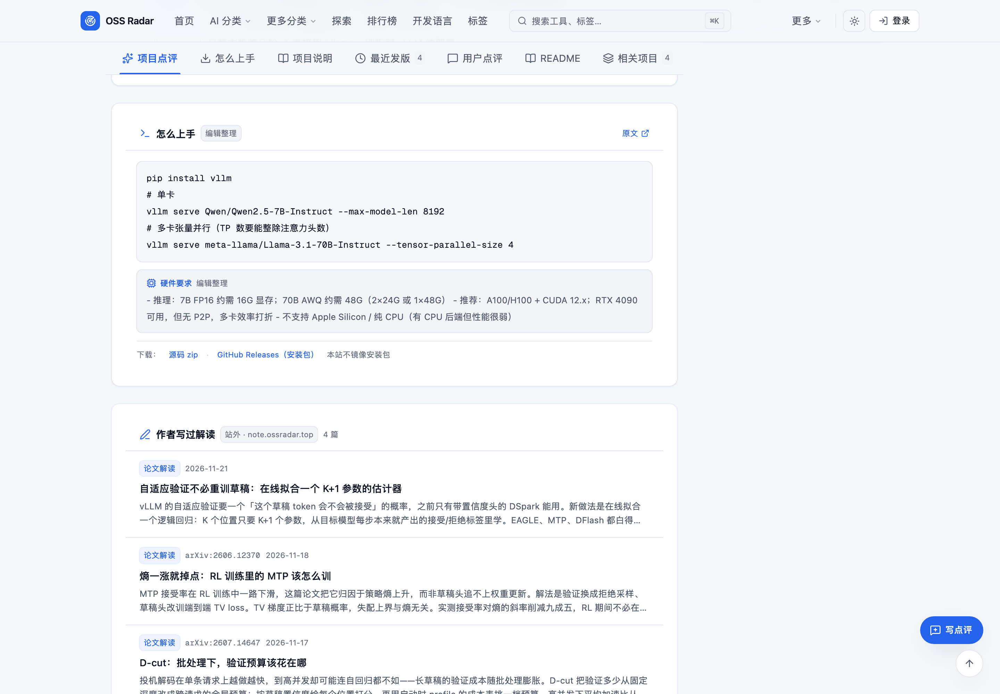
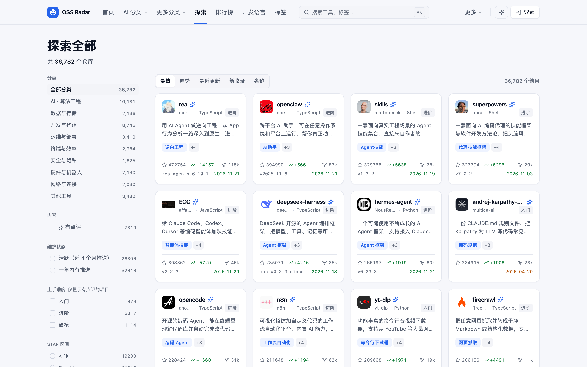

# OSS Radar

**Find the open-source tool you need for a specific job — not a list of 36,000 repositories sorted by stars.**

[**git.ossradar.top**](https://git.ossradar.top) · 中文站

---

## The problem

Ask a general software directory for a "vector database" or an "LLM inference engine" and
you get a hundred entries with a one-line English description and a star count. That
tells you what exists. It does not tell you which one you should use, whether it fits
in 24 GB of VRAM, or what breaks the first afternoon you run it.

Ask a "best AI tools" list instead and you get the opposite problem: twenty general-purpose
chat clients and image generators mixed with the infrastructure you were actually looking for.

## What this site does

It organises open-source tools **by the engineering task you are doing**, at a granularity
where every entry is a real choice.

|  | |
| --- | --- |
| **36,700+** repositories | synced from GitHub every few hours |
| **10,100+** under AI | split across **58** sub-topics of a workflow |
| **142** leaf categories | no empty categories — every one has entries |
| **7,300+** project reviews | written per project, not per category |

Counts as of the 2026-11-23 sync. The site header always shows the current numbers.

The AI tree follows the pipeline rather than the hype: serving and inference — training and
fine-tuning — agent orchestration — retrieval and RAG — evaluation and MLOps — training data —
multimodal generation — vision and 3D — model toolchain — paper implementations.
Deployment goes under *serving*, training goes under *fine-tuning*, and observability
goes under *MLOps*, because that is the order you touch them in.

## What each project page answers

Every project page carries the things you would otherwise spend an hour piecing together
from the README, the issue tracker and a blog post:

- **What it is**, in one Chinese sentence, plus what it replaces in your stack
- **Where it fits** — the concrete workflow, and what happens if you pick a different tool
- **Hardware** — actual VRAM requirements, not "GPU recommended"
- **Difficulty** — 入门 / 进阶 / 硬核
- **Pitfalls** — the specific symptom and its cause, e.g. *"starts and immediately hits
  CUDA OOM: `--max-model-len` exceeds the KV cache your card can hold"*
- **How it compares** to the alternative you were also considering

## Filter by the constraint you actually have

Browsing is by category, then filtered on the things that decide a choice: language,
license, self-hostable or not, hardware requirement, how actively maintained.

## Search that understands Chinese

Searching in Chinese for a technical tool is not the same problem as searching in English.
"推理" can mean model inference or logical reasoning; "量化" can mean model quantisation or
quantitative trading. The site resolves those by context rather than by keyword frequency,
and it handles the case where the tool you want never uses your word — search "本地跑大模型"
and you still get the engines that only ever say "local inference".

Keyword index and semantic recall, then a reranker that decides the order.

---

## How it is built

The source is not public. This repository is the front door: what the site does, and where
to report that it does something wrong.

## Reporting problems

- **A project is in the wrong category, its description is inaccurate, or a link is dead** —
  [open an issue](../../issues).
- **You want a tool added** — say which one and what you use it for; a concrete use case
  gets it classified properly.
- **A review reads wrong** — quote the sentence. Reviews are generated from the README and
  the issue tracker, and a claim that does not hold up is worth fixing.

There is also a feedback form on the site itself, at
[git.ossradar.top/feedback](https://git.ossradar.top/feedback).

## What the data is, and is not

Star counts, licenses, languages and release dates come from the GitHub API and are
accurate as of the last sync (shown on the site). Chinese descriptions and reviews are
generated by a language model reading the README and the issue tracker — treat them as
*"someone read this for you"*, not as an expert verdict. Anything that matters for a
production decision, verify yourself.

Reviews are written from verifiable external signals — issue titles, Hacker News discussion
threads, release notes — and the language model is instructed not to state community
consensus it cannot point to. It still gets things wrong sometimes; that is what the
issue tracker is for.

---

Not affiliated with GitHub. Project names and logos belong to their respective owners.
